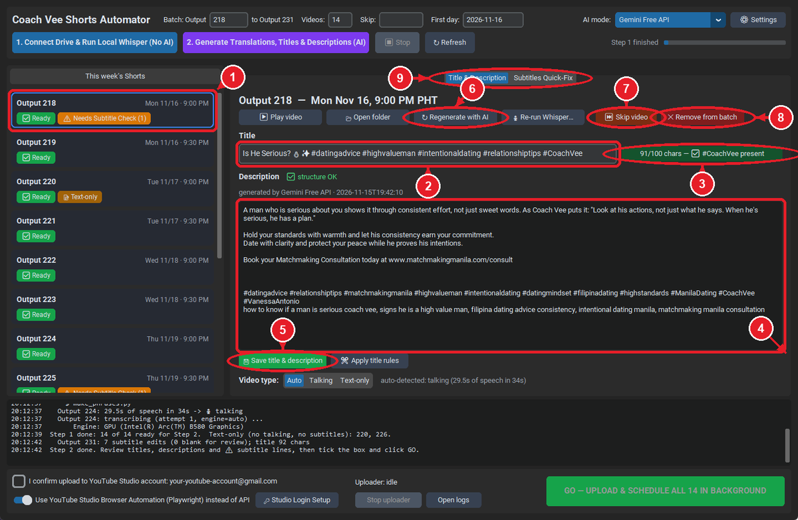
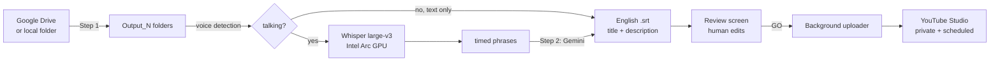
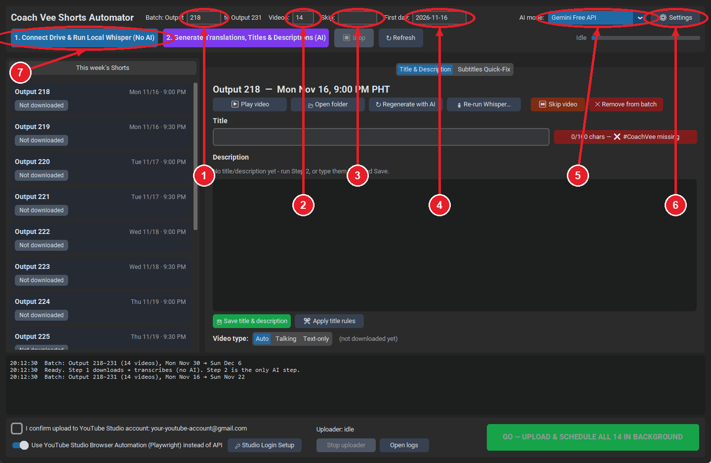
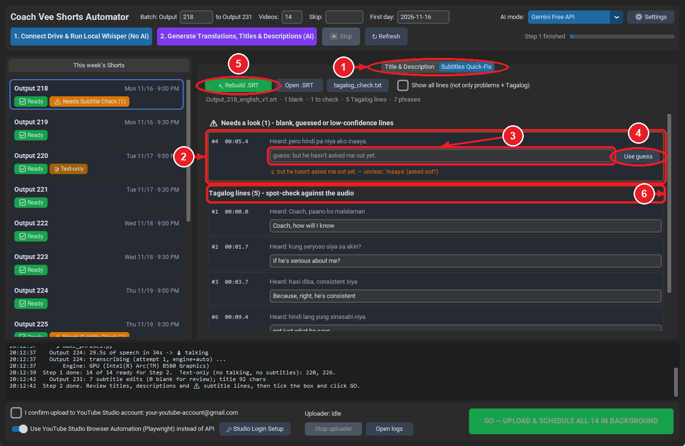
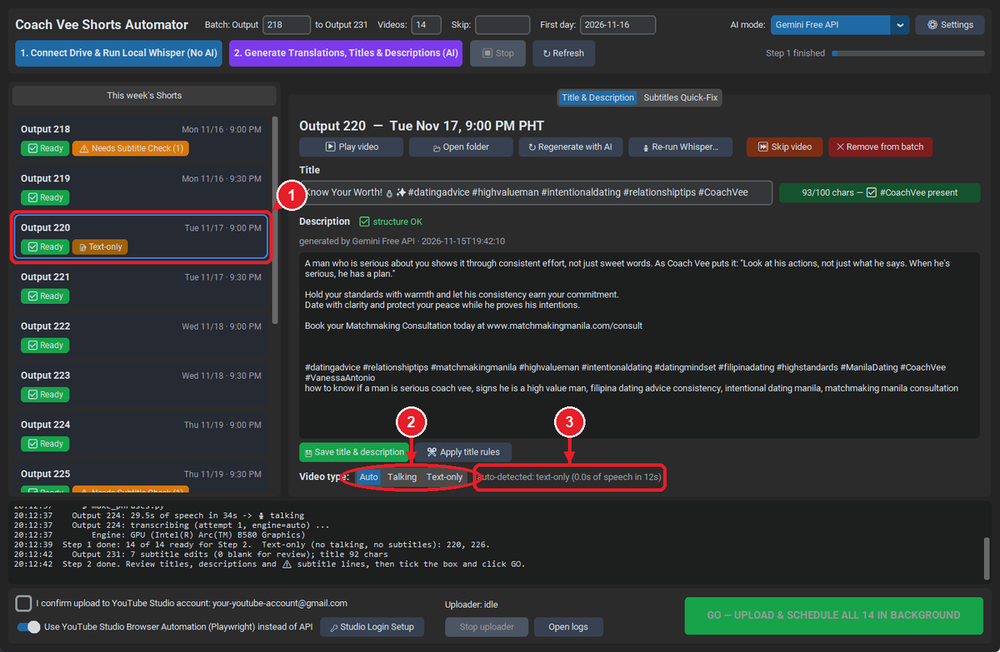
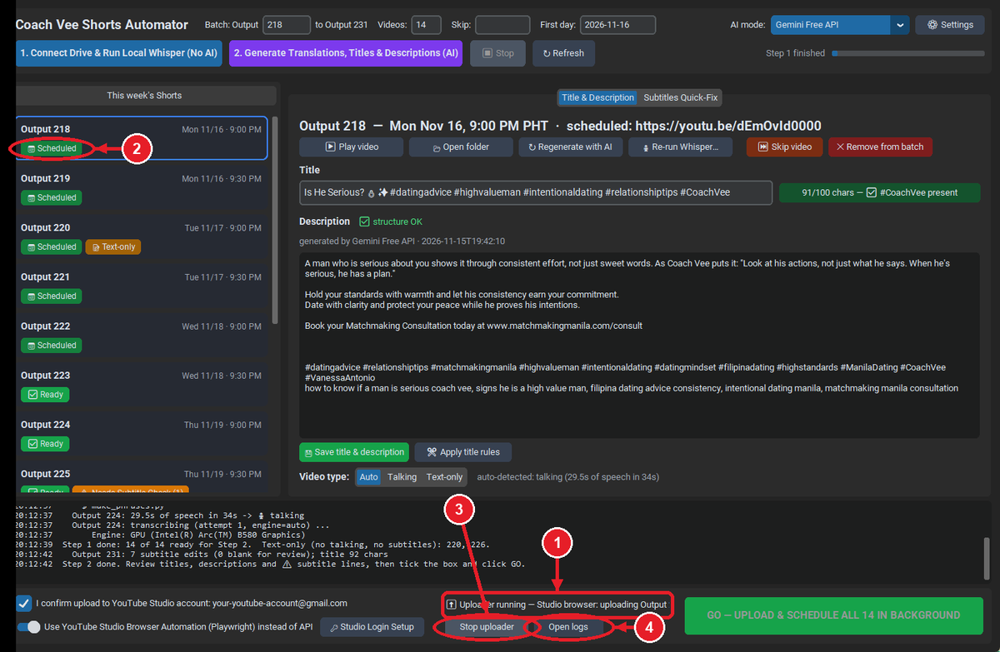

<div align="center">

# 🎬 CoachVee YT Automator

**A Windows desktop app that turns a folder of finished Shorts into a fully scheduled YouTube week — with English subtitles for Taglish videos, on-brand titles & descriptions, and a human review step before anything goes live.**


-0071C5?logo=intel&logoColor=white)




</div>

---

## ✨ What it does

Every week a video editor drops 10–14 finished vertical Shorts (`OUTPUT218_FINAL.mp4`, `OUTPUT219_FINAL.mp4`, …).
Before this app, each one needed a Taglish → English subtitle file, a title, a description, hashtags and a
publish slot — typed by hand in YouTube Studio. Now it is **five clicks and a review**:

| # | Step | AI? | What happens |
|---|---|:---:|---|
| 1 | **Collect** | ❌ | Downloads `Output N` videos from a Google Drive folder — or just drop the files in a folder and the app sorts them into `Output_N\` by itself. |
| 2 | **Transcribe** | ❌ | Runs **OpenAI Whisper large-v3 locally on an Intel Arc GPU**, one video at a time. Detects text-only filler videos (no talking) and skips them. Catches Whisper's "missed the first 30 s" glitch and re-runs on CPU. |
| 3 | **Translate & write** | ✅ | The **only** AI step: Gemini (free tier) translates Taglish phrases to English subtitles and writes the title/description. For text-only videos it reads the on-screen text from video frames. |
| 4 | **Review** | ❌ | A desktop review screen: live title-length check, description structure check, and a quick-fix table for unclear subtitle lines. Nothing is uploaded until you click **GO**. |
| 5 | **Schedule** | ❌ | A detached background uploader puts every video on YouTube as **private + scheduled** (9:00 PM / 9:30 PM Manila), attaches the `.srt`, verifies Studio's *"Video scheduled"* confirmation, and resumes after crashes without uploading twice. |



## 🧩 Highlights

- **Human-in-the-loop by design** — AI output is never published directly. Two account-confirmation tick boxes (Drive and YouTube) guard every sign-in and upload.
- **Taglish-aware subtitles** — translation happens *per spoken phrase*, so English lines stay in sync with the voice even when word order changes; voice-activity snapping stops lines from appearing early.
- **Rules enforced in code, not prompts** — titles are guaranteed `< 100` characters with `#CoachVee` last (the last hashtag is auto-trimmed), and the 5-part description (insight → takeaway → CTA → hashtag block → SEO line) is assembled by Python from AI-written pieces, so the format can't drift.
- **Text-only filler support** — speech detection spots music-and-text videos; Gemini reads the on-screen text from 16 frames and writes the metadata; they upload without captions.
- **Resilient uploads** — progress is saved after every video, YouTube quota pauses wait for the daily reset, a busy Gemini model falls back to a lighter one automatically, and the Studio browser path waits for YouTube's own confirmation before marking anything "scheduled".
- **Flexible batches** — any start number, any count, any first day; a **Skip** list and **Skip video / Remove from batch** buttons; slot-clash protection against already-scheduled weeks.
- **₱0 running cost** — local GPU transcription, free Gemini tier, free Google APIs, no billing account.

## 🖼️ Screenshots

| Main window | Subtitle quick-fix |
|---|---|
|  |  |
| **Text-only filler detection** | **Background upload & schedule** |
|  |  |

## 🛠️ Tech stack

| Layer | Tools |
|---|---|
| Desktop app | Python 3.14, CustomTkinter, Pillow |
| Speech-to-text | OpenAI Whisper `large-v3` on PyTorch XPU (Intel Arc B580), faster-whisper (CPU fallback), Silero VAD |
| Media | ffmpeg (audio decode, frame extraction) |
| AI (Step 2 only) | Google Gemini via `google-genai` (`gemini-3.5-flash` → `gemini-3.5-flash-lite` fallback) · optional Claude Code CLI (`claude -p`) |
| Google APIs | OAuth 2.0 (desktop client), Drive API v3 (read-only), YouTube Data API v3 |
| Uploading | Playwright driving Google Chrome (YouTube Studio) · or YouTube Data API `videos.insert` + `captions.insert` |
| OS integration | Detached background process, Windows toast notifications, keep-awake, desktop shortcut |

## 📁 Repository layout

```
├── README.md
├── docs/
│   ├── SETUP.md                 ← step-by-step tutorial with annotated screenshots
│   └── images/
├── transcribe.py                ← Whisper pipeline (step 1: transcribe on the Intel Arc GPU)
├── make_phrases.py              ← step 2: split into short, exactly-timed phrases
├── merge_edits.py               ← step 3: merge translations (+ name spelling fixes)
├── build_srt.py                 ← step 4: build the .srt, snapped to the real voice
├── WHISPER_PIPELINE_HANDOFF.md  ← how the pipeline works and what must not change
├── requirements-whisper.txt
└── automation_app/
    ├── app_gui.py               ← the desktop app
    ├── common.py                ← paths, config/state, schedule math, status, auto-organize
    ├── drive_service.py         ← Google Drive search + download
    ├── whisper_runner.py        ← calls the 4 pipeline scripts, one video at a time
    ├── detect_speech.py         ← talking vs text-only detection (runs in the Whisper venv)
    ├── ai_processor.py          ← the only AI step (Gemini / Claude CLI) + JSON validation
    ├── metadata_rules.py        ← title & description rules, enforced in code
    ├── background_uploader.py   ← detached, resumable uploader / scheduler
    ├── youtube_playwright_fallback.py ← YouTube Studio browser automation
    ├── google_auth.py           ← OAuth for the two accounts, with account verification
    ├── config.example.json / state.example.json
    ├── requirements.txt
    └── Launch_CoachVee_Automation.bat · Install_or_Repair_App.bat · create_desktop_shortcut.py
```

## 🚀 Quick start

> Full walkthrough with annotated screenshots: **[docs/SETUP.md](docs/SETUP.md)**

```bat
:: 1. Whisper pipeline (Python 3.11 venv in the repo folder)
py -3.11 -m venv venv
venv\Scripts\pip install -r requirements-whisper.txt

:: 2. Desktop app (needs a Python 3.12+ that includes Tk)
cd automation_app
Install_or_Repair_App.bat

:: 3. Settings
copy config.example.json config.json   & :: then add your Gemini key in the app's Settings
copy state.example.json  state.json    & :: put your Drive + YouTube account emails here
:: put Google's client_secret.json in automation_app\tokens\
```

Then double-click the **Coach Vee YouTube Automator** desktop icon.

**Weekly routine:** drop the videos in the jobs folder → **1. Run Local Whisper** → **2. Generate (AI)** → review → tick the confirmation → **GO**. You get a Windows notification when the whole batch is scheduled.

## ⚙️ Configuration

<details>
<summary><b>config.json</b> (machine settings — never committed)</summary>

| Key | Default | Meaning |
|---|---|---|
| `whisper_python` | `D:\whisper\venv\Scripts\python.exe` | Interpreter for the 4 pipeline scripts |
| `ffmpeg_path` | `D:\ytdl\ffmpeg.exe` | ffmpeg binary |
| `staging_dir` | `D:\bot\jobs` | Where videos and Whisper output live (`Output_N\`) |
| `srt_max_chars` | `30` | Max characters per subtitle line (30 = vertical Shorts, 45 = landscape) |
| `ai_provider` | `gemini` | `gemini` or `claude_cli` |
| `gemini_api_key` | — | Free key from Google AI Studio |
| `gemini_model` / `gemini_fallback_models` | `gemini-3.5-flash` / `[…-lite]` | Main model and automatic backups |
| `upload_method` | `api` | `api` (YouTube Data API) or `playwright` (Studio browser) |
| `client_secret_path` | `automation_app\tokens\client_secret.json` | Google OAuth desktop client |
</details>

<details>
<summary><b>state.json</b> (batch progress — never committed)</summary>

| Key | Meaning |
|---|---|
| `next_start_index` | First Output number of the next batch (advances automatically) |
| `batch_size` | Default number of videos per batch |
| `drive_folder_name` | Drive folder to search (subfolders included) |
| `drive_email` / `youtube_email` | The two Google accounts; every sign-in is checked against them |
| `daily_slots_pht` | Publish times per day, Asia/Manila |
| `skipped_outputs` | Output numbers left out of batches |
| `completed_outputs` | Per-video YouTube ID, status and publish time (used to resume and to prevent duplicates) |
</details>

## 🔒 Privacy & security

- `config.json`, `state.json`, `tokens/`, `logs/`, the Chrome profile and all video data are **git-ignored** (the `.gitignore` is an allow-list).
- Google sign-ins are verified: signing in with the wrong account saves nothing.
- Drive access is **read-only**. The Studio browser profile is signed in by hand — the app never types a password.
- Free-tier Gemini prompts may be used by Google to improve its products; switch AI mode to Claude CLI if transcripts must stay private.

## 🩺 Troubleshooting

See the table at the end of **[docs/SETUP.md](docs/SETUP.md#troubleshooting)** — GPU out of memory, Gemini overloaded, Studio drafts, quota limits, wrong account, slot clashes and more.

## 🗺️ Roadmap

- [ ] Same pipeline for TikTok / Instagram Reels / Facebook
- [ ] YouTube API audit → switch from Studio browser automation to the official API
- [ ] One-click cleanup of leftover Studio drafts

---

<div align="center">
Built for the Coach Vee channel · Matchmaking Manila
</div>
