# Setup & usage tutorial

Red numbers in each picture match the numbered steps under it.
Screenshots use demo data and placeholder accounts (`your-drive-account@gmail.com`, `your-youtube-account@gmail.com`).

**Contents**
- [Part A — one-time setup](#part-a--one-time-setup)
  - [A0. Install](#a0-install)
  - [A1. Google login file (`client_secret.json`)](#a1-google-login-file-client_secretjson)
  - [A2. AI key](#a2-ai-key-step-2-only)
  - [A3. Choose how videos get published](#a3-choose-how-videos-get-published-important)
  - [A4. Your accounts and Drive folder](#a4-your-accounts-and-drive-folder)
- [Part B — every week](#part-b--every-week)
- [Badges](#badges)
- [Troubleshooting](#troubleshooting)

---

## Part A — one-time setup

### A0. Install

**You need:** Windows 10/11 · an Intel Arc GPU (B580 tested; other GPUs fall back to the CPU) · [ffmpeg](https://ffmpeg.org/) · Google Chrome · Python **3.11** (Whisper) and Python **3.12+ with Tk** (the app).

The scripts expect this layout (change the paths in `config.json` and at the top of `transcribe.py` if yours differ):

```
D:\whisper\                 ← this repository
D:\whisper\venv\            ← Whisper venv (Python 3.11)
D:\whisper\models\          ← Whisper model cache (downloaded on first run, ~3 GB)
D:\ytdl\ffmpeg.exe
D:\bot\jobs\                ← one Output_N folder per video (created automatically)
```

1. **Whisper venv**
   ```bat
   cd D:\whisper
   py -3.11 -m venv venv
   venv\Scripts\pip install torch --index-url https://download.pytorch.org/whl/xpu
   venv\Scripts\pip install openai-whisper faster-whisper
   ```
2. **The app** — double-click `automation_app\Install_or_Repair_App.bat`. It builds `automation_app\.venv`, installs `requirements.txt` and puts a **Coach Vee YouTube Automator** icon on your Desktop.
3. **Settings files** — the app creates `config.json` and `state.json` on first start. Templates: `config.example.json`, `state.example.json`.

### A1. Google login file (`client_secret.json`)

One file lets the app sign in to **both** Google accounts (the Drive account and the YouTube account). It is free; no billing account is needed.

1. Open [console.cloud.google.com](https://console.cloud.google.com/) → project picker → **New project** → name it (e.g. `CoachVee YT Automator`) → **Create**. Make sure it is selected in the top bar.
   > If the new project doesn't appear: open the **All** tab of the picker and click **No organization** — projects are listed under it.
2. Search bar → **Google Drive API** → **Enable**. Then **YouTube Data API v3** → **Enable**.
3. ☰ → **APIs & Services → OAuth consent screen** → **Get started**: app name, support email → **External** → contact email → agree → **Create**.
4. **Audience → Test users → + Add users** → add **both** accounts (Drive and YouTube) → **Save**.
5. **Clients → + Create client → Desktop app** → **Create** → **Download JSON** immediately.
6. Rename the file to exactly `client_secret.json` and put it in `automation_app\tokens\`.
7. *(Recommended)* **Audience → Publish app** — otherwise Google logs the app out every 7 days.

The first time the app signs in, the browser shows *"Google hasn't verified this app"* — expected for your own app. Click **Continue**, tick all the permission boxes, **Continue**. If you choose the wrong account, the app refuses and saves nothing.

> ⚠️ Don't click **Try for free / Activate** on the Google Cloud free-trial banner. Without a billing account nothing can be charged.

### A2. AI key (Step 2 only)

**Option 1 — Gemini (free, recommended)**
1. [aistudio.google.com/apikey](https://aistudio.google.com/apikey) → **Create API key** (pick your Cloud project) → copy it. *Free tier* = no charges; ignore "Set up billing".
2. App → **⚙ Settings** → paste into **(1) Gemini API key** → **(5) Save**.

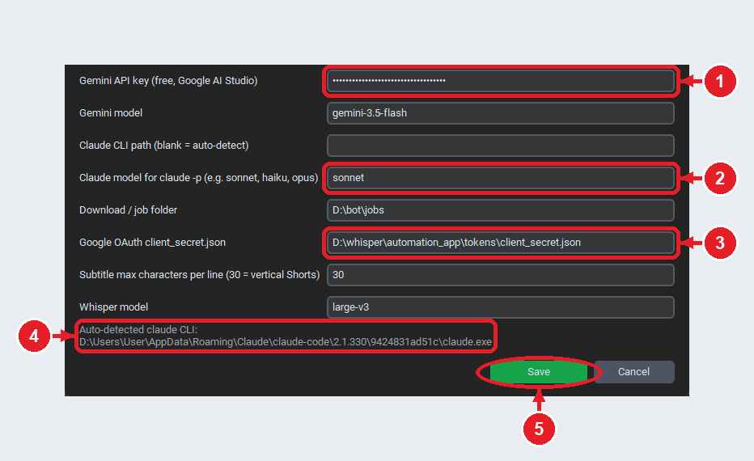

If the main model is overloaded, the app switches to the backup model by itself (and remembers it for 15 minutes).

**Option 2 — Claude CLI** (uses your Claude plan). The CLI bundled with the Claude desktop app must be signed in once:
```powershell
& (Get-ChildItem "$env:APPDATA\Claude\claude-code\*\*\claude.exe" | Sort-Object LastWriteTime | Select-Object -Last 1).FullName
```
type `/login`, finish in the browser, `/exit`. Then pick **AI mode → Claude CLI (Batch -p)**. (Text-only videos still use Gemini, because they need image reading.)

### A3. Choose how videos get published (important)

Videos uploaded through the YouTube **API** from an *unaudited* Cloud project are locked to **Private** by Google, so scheduled videos would never go public.

| Route | When | How |
|---|---|---|
| **Studio browser** (works now) | until your project passes the audit | Turn on switch **(2)**, click **(3) Studio Login Setup**, sign in by hand as the YouTube account in the Chrome window that opens, then close it. |
| **Official API** | after Google approves the [YouTube API audit form](https://support.google.com/youtube/contact/yt_api_form) | Turn switch **(2)** off. |

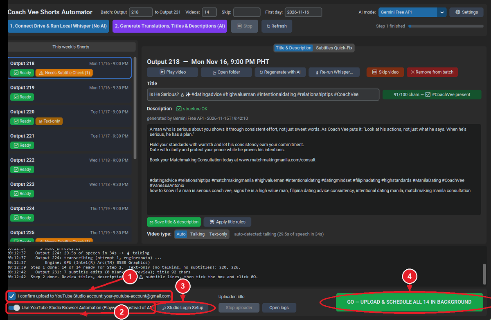

### A4. Your accounts and Drive folder

Edit `automation_app\state.json` (close the app first):

```json
"drive_folder_name": "EDITOR | SEM",
"drive_email": "your-drive-account@gmail.com",
"youtube_email": "your-youtube-account@gmail.com",
"daily_slots_pht": ["21:00:00", "21:30:00"],
"next_start_index": 218
```

Drive videos can be named `Output 218.mp4`, `OUTPUT218_FINAL.mp4`, `output_218 final.mov` … and may sit in subfolders like `OUTPUT 218 | INTERVIEW`.

---

## Part B — every week

> Close CapCut, games and other GPU-heavy apps first.

### B1. Pick the batch

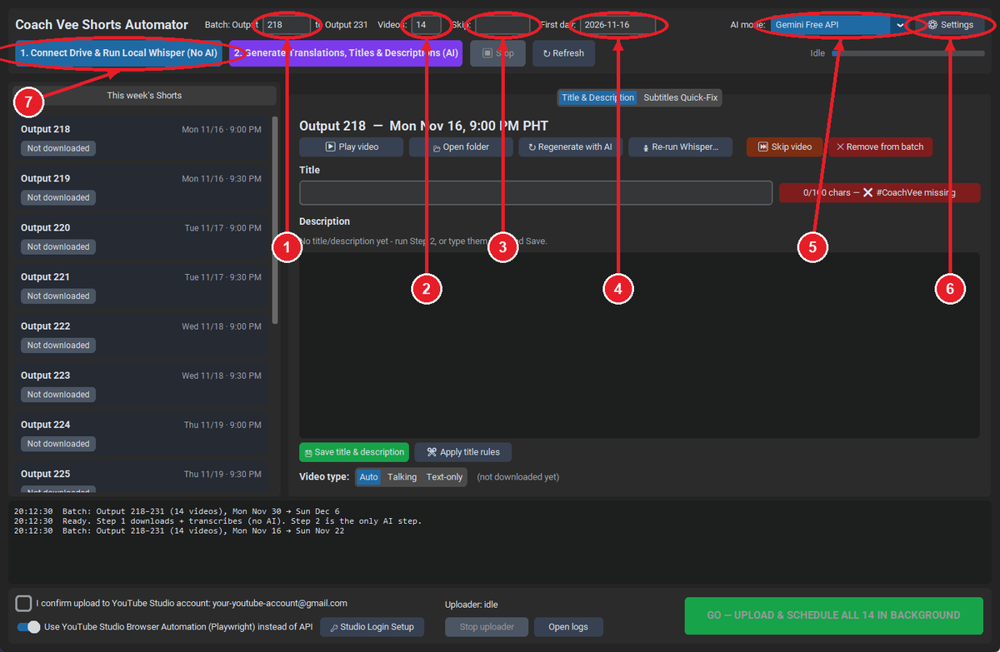

1. **Batch: Output** — first Output number (advances by itself after each successful batch).
2. **Videos** — how many (e.g. 14 = Mon–Sun × 2).
3. **Skip** — Output numbers to leave out, e.g. `241` or `245-247`.
4. **First day** — date of the first slot. Defaults to the day after your last scheduled video. If the batch would run into slots that are already taken, it is shortened automatically.
5. **AI mode** · 6. **Settings** · 7. **Step 1**.

**Videos from another Drive / manual downloads:** just drop the `.mp4` files into `D:\bot\jobs\`. On start, **↻ Refresh**, a batch change or Step 1, each `OUTPUT###…` file is moved into its own `Output_###\` folder (files still copying are left for the next refresh; nothing is ever overwritten).

### B2. Confirm the Drive account

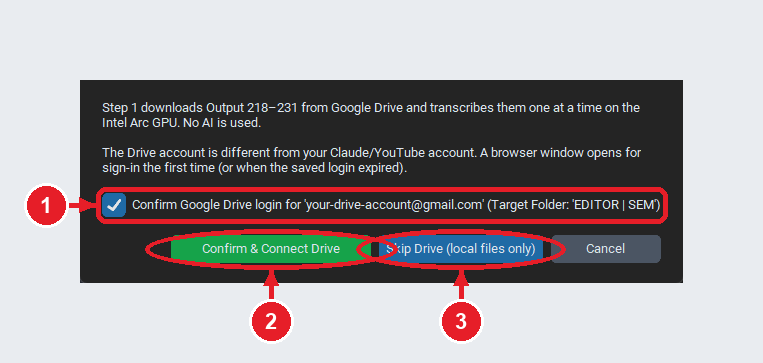

1. Tick the confirmation (the green button stays grey until you do).
2. **Confirm & Connect Drive** — or 3. **Skip Drive (local files only)** if the videos are already in the jobs folder.

### B3. Download + transcribe (no AI)

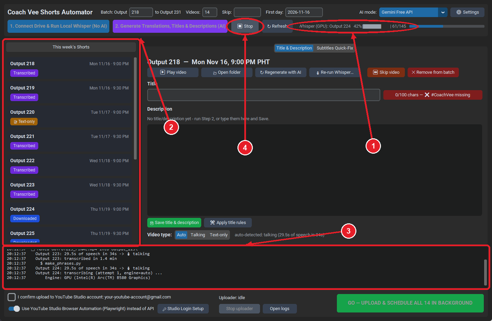

1. Live progress. 2. Each video: **Downloaded → Transcribed** (or **📝 Text-only**). 3. Log. 4. **Stop** (Step 1 resumes later; finished videos are skipped).

Behind the scenes, for each video:
- voice detection decides **talking** vs **text-only** (under 3 s of speech or under 12% of the video);
- Whisper runs on the GPU, one video at a time; failures retry, then fall back to the CPU;
- if the GPU pass caught less than half of the measured talking, it is re-checked on the CPU and the better result is kept.

### B4. Generate (the only AI step)

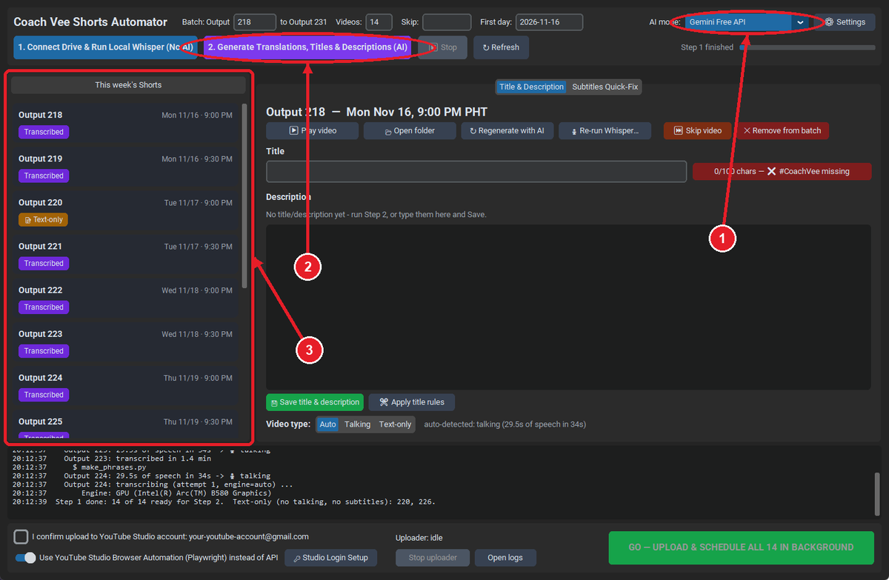

1. Check **AI mode**. 2. **2. Generate Translations, Titles & Descriptions** → **Yes**. 3. Rows turn **✅ Ready**. Nothing is uploaded yet.

### B5. Review titles & descriptions

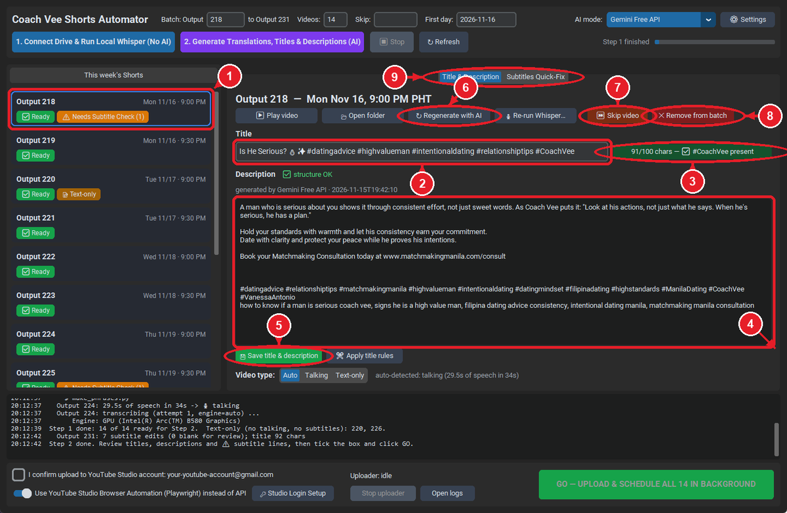

1. Pick a video (**⚠️ Needs Subtitle Check** = blank subtitle lines).
2. Title — edit freely. 3. Must be **green**: under 100 characters with `#CoachVee` (click **✂ Apply title rules** to trim).
4. Description — the CTA, blank lines, hashtag block and SEO line are built automatically; *✅ structure OK* confirms it.
5. **Save** (also saves when you switch videos). 6. **Regenerate with AI**.
7. **⏭ Skip video** — leave it out; the next Output number moves in. 8. **✕ Remove from batch** — batch becomes one shorter.
9. Switch to **Subtitles Quick-Fix**.

### B6. Fix flagged subtitle lines

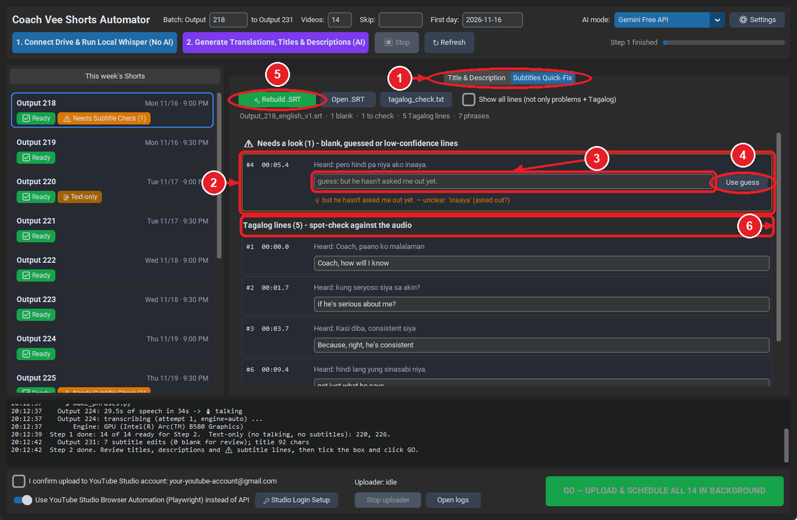

1. Tab. 2. Orange = blank or unsure lines, always first. 3. Type the English line (see *Heard:*). 4. **Use guess**. 5. **🔨 Rebuild .SRT** (new `_v2`, `_v3`… never overwritten; GO also rebuilds for you). 6. Tagalog lines for spot-checks.

### B7. Text-only filler videos

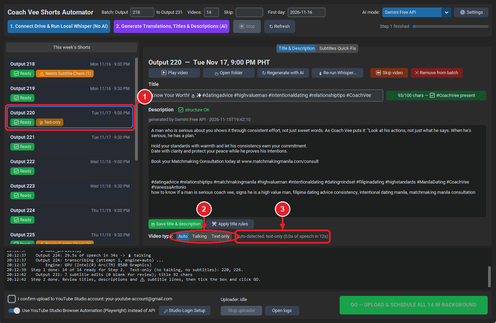

1. **📝 Text-only** badge — no Whisper, no subtitles; Gemini reads the on-screen text from 16 frames and writes the title.
2. **Video type: Auto / Talking / Text-only** — override if detection is wrong (e.g. a song with lyrics). 3. What was detected.

### B8. GO


1. Tick **I confirm upload to YouTube Studio account: …**. 2. Upload route (A3). 4. **GO**, then check every slot and click **Yes**:

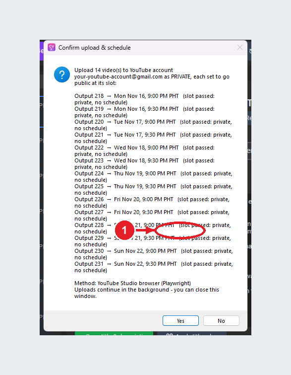

### B9. Uploads run in the background

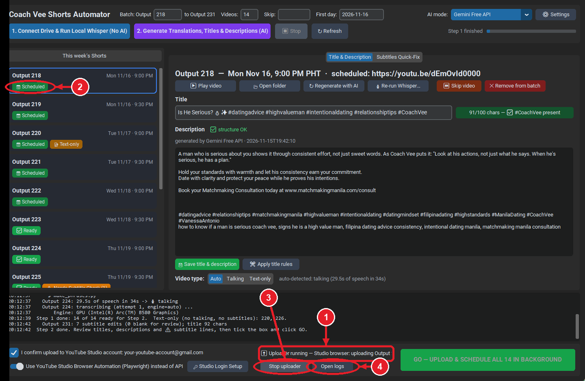

1. Uploader status — you can close the app. 2. **📅 Scheduled** badges. 3. **Stop uploader** (GO resumes; nothing is uploaded twice). 4. **Open logs**.

When the batch is done you get a Windows notification and the batch number moves on. Keep the PC on and online until then; a YouTube quota pause waits for the daily reset (~4 PM Manila) by itself.

After the first batch, open **YouTube Studio → Content → Shorts** and check: **Scheduled**, correct date/time, **English** under Subtitles.

---

## Badges

| Badge | Meaning | Do |
|---|---|---|
| Not downloaded | No video in `Output_N\` | Step 1, or drop the file in the jobs folder |
| Downloaded / Transcribed | Waiting for Whisper / AI | Run the next step |
| 📝 Text-only | No talking detected | Nothing — or override the video type |
| ✅ Ready | Video + subtitles + valid title/description | Review, GO |
| ⚠️ Needs Subtitle Check (n) | n blank subtitle lines | Quick-Fix tab |
| rebuild .SRT | Edited lines not rebuilt yet | Rebuild (or GO does it) |
| 📅 Scheduled | Confirmed by YouTube | Nothing |
| ⚠️ Draft in Studio | Uploaded but not scheduled | GO schedules the existing draft (no re-upload) |
| ❌ error / Upload failed | See the log | Fix, run the step again |

## Troubleshooting

| You see | Do this |
|---|---|
| `client_secret.json not found` | A1 step 6 — exact name and folder |
| "You signed in as X, but this step must use Y" | Sign in again and pick the right account |
| "Access blocked … verification" | Add the account under **Test users** (A1 step 4) |
| Gemini "busy / 503 / timed out" | Nothing — it retries and switches to the backup model |
| `claude CLI is not signed in` | A2 option 2 |
| Whisper ❌ / GPU out of memory | Close GPU apps → select the video → **🎙 Re-run Whisper…** |
| Subtitles start late / whole intro missing | Automatic CPU re-check; or **Re-run Whisper… → CPU** |
| Video shows *Not downloaded* although the file is in `jobs` | Click **↻ Refresh** — it is moved into `Output_N\`. If two videos exist for one number, the log asks you to remove one |
| ⚠️ Slot clash | Change **First day** or **Videos**; the batch auto-shortens before taken slots |
| Studio shows **Draft** | Click GO — drafts are scheduled in place; check Studio for leftover duplicate drafts and delete them |
| "We're still checking your content" in Studio | Handled automatically (clicks *Got it*) |
| Videos stay Private after their time (API route) | Unaudited project lock — use the Studio route (A3) |
| App won't open | `automation_app\Install_or_Repair_App.bat` |
